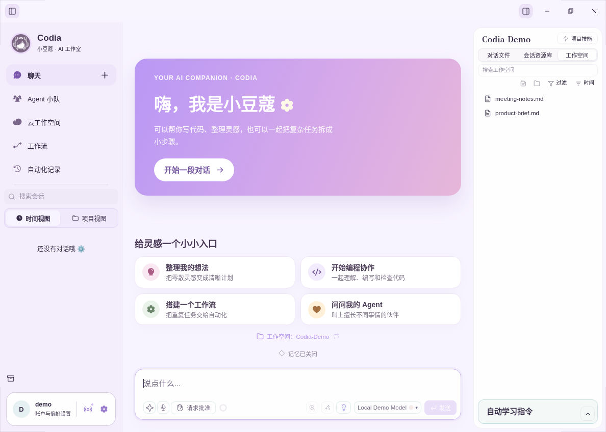
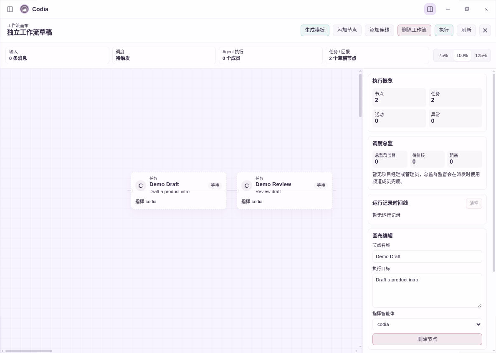

<p align="center">
  
</p>

<h1 align="center">Codia · 小豆蔻</h1>

<p align="center"><strong>最懂你的 AI 工程小精灵</strong></p>

<p align="center">
  <a href="https://github.com/BaiQiaochu/Codia/releases/latest">下载体验</a> ·
  <a href="#主要能力">了解功能</a> ·
  <a href="#文档与来源">参与项目</a>
</p>

## Codia 是什么

Codia（小豆蔻）是一个有记忆、能使用工具、具有多agent协作能力的操作系统级桌面 AI 助手。你可以和它交流还没成形的想法，也可以把手头的资料交给它，整理笔记、查找信息、起草文档、处理文件；或者把需求和标准告知她，和她一起做工程、写代码。

你可以在对话中查看或更改你的工作空间，这里集中呈现你选择的资料与文件夹。资料可以拿来讨论，讨论可以形成文件；需要另一种视角时，还能叫上擅长不同事情的助手。顺手的方法与成熟的经验，可以保存为技能或工作流，留给下一次使用。

小豆蔻欢迎打工人、学生党，以及所有需要电脑来工作的人的使用。准备一份周报、读懂一组材料、梳理一个项目，都可以从一句自然的描述开始。



*云电脑实际编译运行的开发版界面（基于 0.3.1，演示工作空间与本地模拟模型），不是模型生成图。截图含云端功能开发入口，不代表 `main` 已发布该能力。*

## 主要能力

### 记忆与个性，让交流有延续

Codia 支持对话摘要、长期记忆和手动固定的重要信息，用来保留偏好、背景和讨论中的要点，帮助后续交流少一些从头解释。你也可以为助手设置名字、行为风格与模型，让写作伙伴、研究助手和编程搭档各有侧重。

欢迎页里的 Live2D 小豆蔻，为这个工作空间添了一点陪伴感。角色使用仓库内的模型与贴图在本地渲染，不需要为角色另外调用 AI 模型。

### 对话连着文件，也连着能动手的工具

把文档、图片和工作文件夹放进对话上下文，Codia 就能围绕具体资料开展工作：阅读与摘要、修改文本、编写代码、执行命令，再把结果放回工作空间供你预览和检查。

内置文档助手覆盖 PDF、Word、Excel 和 PowerPoint 的读取与部分编辑；内置浏览器让资料检索、网页阅读和页面操作也能接进任务。需要操作桌面应用时，Windows 和 macOS 还提供可单独开启的电脑操作能力。

### Agent 小队，给复杂任务多几个视角

你可以创建多个助手，在同一个频道里分工：一位整理资料，一位起草，一位负责挑出问题。也可以只请另一位助手做一次审阅，再由原助手汇总意见、继续完成任务。

助手分工由你提出，过程中可以查看各自的结果。它适合那些需要反复讨论、检查和修改的工作，例如研究摘要、项目方案和代码审阅。

### 把做顺手的方法，留成下一次的工作流

可视化工作流把步骤、助手和执行顺序组织起来，支持节点与连线、草稿保存、模板预览和运行状态。你可以先把一件事做清楚，再把成熟步骤留下来。

对于周期性的整理与检查，也可以创建定时任务，让 Codia 在本机服务运行期间按计划开展工作。



*工作流画布实拍：手动建立的演示草稿，可编辑节点、任务目标与连线；图中任务尚未执行。*

### 让想法有更多表达方式

长篇资料可以整理成知识图谱，零散笔记可以变成思维导图；图谱和导图能在聊天中预览，思维导图还可保存为 `.xmind` 文件。接入相应服务后，也能用图片、视频与声音表达想法。

### 模型和扩展，按你的需要选择

Codia 提供 OpenAI、Anthropic、Gemini、DeepSeek、通义千问、火山引擎、智谱、Moonshot/Kimi、MiniMax、OpenRouter、Ollama 等供应商入口。可以按任务选择模型，也可以连接自己运行的本地模型服务。

技能帮助助手沿用一套做事方法，插件与 MCP 连接器带来额外工具。Telegram、飞书、钉钉、QQ、微信 iLink、WhatsApp 等消息平台也有对应接入，让你能从已配置的平台继续和助手交流。

## 可以一起做些什么

- **整理一周的工作。** 把会议纪要和进度资料交给小豆蔻，梳理完成事项、负责人、风险与待确认问题，再请另一位助手审阅，留下你可以继续修改的周报草稿。
- **读懂一个新主题。** 围绕几份资料讨论关键概念，追问结论的原文依据，把内容整理成笔记或思维导图，逐步形成自己的理解。
- **推进一个小项目。** 从想法和需求开始，拆分步骤，整理文件、编写代码或内容、检查结果，再把反复用到的做法保存下来。
- **设计一个工作流。** 通过内置工作流模板，将经验与标准化流程提炼成属于个人的工作流体系，输出稳定，事半功倍。

这些场景需要相应的模型、资料与工具已经可用。AI 的理解与输出仍需要复核，重要文件建议先用副本试跑。

## 开始体验

从 [最新正式版](https://github.com/BaiQiaochu/Codia/releases/latest) 下载适合你电脑的安装包。当前 `v0.3.1` 提供 Windows x64、Linux x64，以及 macOS Apple Silicon / Intel 版本；仓库当前需要获授权的 GitHub 账号访问。

首次打开后，跟随引导连接模型、选择工作文件夹，就可以从一份资料、一个问题或一件想完成的小事开始。

**关于模型与数据：** Codia 本地保存会话和配置，但远程模型、搜索、媒体服务与外部连接器会按功能接收相关内容，也可能产生费用。开源项目不包含模型额度；使用 Ollama 需要自行准备服务与模型。普通会话默认请求批准，你可以调整权限，但仍应检查工具授权和执行结果。

<details>
<summary>平台、运行条件与能力边界</summary>

- 文档的部分操作需要 Python 与对应库；复杂排版保真、扫描 PDF 识别、任意 PDF 改字、宏和自动公式重算不作通用保证，详见[文档助手](skills2set/office-documents/SKILL.md)。
- 记忆整理需要配置辅助模型，后台整理和多助手运行可能增加调用费用。记忆可能遗漏或出错，可核对并更正重要信息。
- 图谱、导图需要相应插件；媒体生成、识图、语音及搜索需要对应服务与能力，不能仅凭聊天模型配置判断可用性。
- 电脑操作目前限 Windows / macOS，默认关闭，需要系统权限与逐应用授权；Linux 不开放此能力。内置浏览器使用独立会话，不会自动接管日常 Chrome。
- 定时任务建议需应用确认；电脑关机、休眠或服务停止时不能保证按时执行。浏览器与移动 PWA 依赖运行中的 Codia 服务，跨设备访问需要配置认证与网络，不是自动云同步。
- 消息平台需要分别配置凭据，群聊、主动发送和媒体能力各不相同。插件权限、沙盒和备份也有边界，文件备份需自行启用。
- Live2D 需要可用的 WebGL2。资源随仓库保存，普通使用无需 Cubism Editor；加载失败可能使角色不显示。
- Windows 安装包无商业代码签名；macOS 使用 ad-hoc 签名且未做 Apple 公证。出现系统提示时，请核对来源、版本与发布页校验文件。

</details>

<details>
<summary>开发者入口：源码运行、检查与项目结构</summary>

## 从源码运行

需要 Git、**Node.js >=24.12.0 <25** 和 npm，建议 Node 24.15.0。

```bash
git clone https://github.com/BaiQiaochu/Codia.git
cd Codia
npm ci
npm start
```

`npm start` 自动启动 Vite、Electron 和独立 Node 服务，**无需先执行 build 命令**。源码数据默认位于 `~/.codia-dev`，可用 `CODIA_HOME` 调整；桌面安装版默认 `~/.codia`。保持终端运行；前端支持热更新，主进程或服务端修改后需重启。缺少原生预编译依赖时需要 Python / C++ 工具链，SQLite 无需 `electron-rebuild`。

## 常用开发命令

```bash
npm run start:local        # 重新构建客户端并启动
npm run start:built        # 使用已有客户端构建
npm run build             # 构建客户端与独立服务端
npm run build:client       # 仅构建客户端
npm run build:server       # 仅构建独立服务端
npm run lint              # 静态检查
npm run typecheck         # 前端与测试类型检查
npm run typecheck:node    # 服务端类型检查
npm test                  # 单元与回归测试
npm run check:local       # 本地检查，默认保留检查产物
```

`start:built` 默认仍运行服务端源码；完整构建后可用 `CODIA_DESKTOP_SERVER_MODE=dist` 验证独立服务端。`npm run e2e:desktop-smoke` 使用隔离配置和本机模拟模型。完整说明见[贡献指南](CONTRIBUTING.md)。勿用 `git clean -fdx` 清理日常环境；它会删除被忽略的依赖、缓存和构建产物。

安装包使用[手动发布工作流](.github/workflows/build.yml)，推送源码或标签不会自动发布。工作流先上传草稿 Release；勾选 `publish_release` 后，所有平台成功才公开发布并附 `SHA256SUMS.txt`。云端不自动递增版本，也不覆盖已发布版本；本地 `dist:win`、`dist`、`dist:linux` 会调用版本递增，运行前检查 [package.json](package.json)。

## 目录

`desktop/` 是 Electron 与 React 界面；`server/` 提供本机 HTTP / WebSocket 服务；`core/` 与 `hub/` 负责助手编排、会话与调度；`lib/` 包含模型、工具、记忆与连接器；`plugins/`、`skills2set/`、`packages/` 提供插件、技能和 SDK；`shared/` 保存共用协议，`scripts/`、`tests/` 分别存放工程脚本与测试。

</details>

## 文档与来源

[贡献指南](CONTRIBUTING.md) · [插件开发](PLUGINS.md) · [Plugin SDK](PLUGIN_SDK.md) · [行为准则](CODE_OF_CONDUCT.md) · [许可证](LICENSE) · [来源与修改说明](NOTICE)

Codia 沿用 **Apache-2.0** 许可证，欢迎问题反馈、文档修订、测试和功能贡献。请保留既有来源与版权说明，勿提交密钥、个人会话或用户文件。

Live2D 等第三方组件保留各自许可，不由项目的 Apache-2.0 统一覆盖。再分发前请阅读 [Cubism SDK 许可](third_party/live2d/cubism-web-5-r.5/LICENSE.md)、[Core 许可](third_party/live2d/cubism-web-5-r.5/Core/LICENSE.md)、[Framework 许可](third_party/live2d/cubism-web-5-r.5/Framework/LICENSE.md)与[第三方声明](third_party/live2d/cubism-web-5-r.5/NOTICE.md)。
